# FaustView™ III — Маммографическая рабочая станция

**FaustView™ III** (`fv3`) — высокопроизводительная настольная медицинская рабочая станция врача-рентгенолога (маммолога), разработанная на базе **Python 3** и **PySide6 (Qt6)**. 

Система предназначена для просмотра полноформатных цифровых маммограмм (DICOM 12/14/16-bit), автоматического анализа комплектности исследований, потоковой синхронизации со сжатием без потерь **HTJ2K (High-Throughput JPEG 2000)**, а также совместной работы с гипотезами искусственного интеллекта (`db.results`) и экспертной врачебной разметкой (`db.new_results`).

---

## 🌟 Ключевые возможности

### 1. Радиологический мульти-вьювер (4 проекции)
* **Стандартная раскладка маммографии**: одновременный просмотр 4 канонических проекций (`R_CC`, `L_CC`, `R_MLO`, `L_MLO`), а также быстрые режимы сравнения пар (`CC`, `MLO`, `Правая`, `Левая`) и полноэкранный режим одного снимка (клавиши `1`–`4`, возврат по `Esc` или двойному клику).
* **Автоматическое анатомическое выравнивание**: интеллектуальное определение положения грудной стенки по массе ткани с автоматическим прижатием левой железы (`L`) к левому краю слота, а правой (`R`) — к правому краю.
* **Аппаратное и LUT-ускорение (23+ Мп за миллисекунды)**: пересчет 16-битных матриц (`MONOCHROME1` / `MONOCHROME2`) в 8-битные текстуры отображения выполняется через предвычисленные 64К-таблицы перекодировки (LUT) и двухступенчатый кэш (оперативный RAM-кэш + дисковый `fast8_v2` кэш `.npz`).
* **Наглядная индикация состояний**: пустые слоты и слоты в процессе загрузки заливаются темно-серым фоном ожидания (`#1e2430`), автоматически переключаясь на глубокий радиологический черный (`#000000`) в момент готовности изображения.

### 2. Инструменты анализа изображения (Floating HUD)
На каждом из 4 снимков расположена перетаскиваемая полупрозрачная панель инструментов (`FloatingToolbar`):
* **Спектральные и рентгеновские палитры**: `Оригинал (VOI LUT)`, `Grayscale (Окно ткани P1..P99.5)`, `Inferno`, `Hot Iron`, `PET / Turbo`, `Magma`, `Bone`, `Viridis`.
* **Локальное контрастирование (CLAHE)**: плавная вертикальная регулировка от `0%` до `100%` (соответствует `clipLimit` от $0.5$ до $6.0$) с индикацией процента прямо на иконке.
* **Инверсия (Негатив)**: мгновенное обращение яркостей строго внутри маски ткани молочной железы.
* **Режим «Авто-ROI» (Кнопка `ROI`)**:
  * Выделяет крупнейший связный контур молочной железы (`cv2.findContours` + морфологическая фильтрация), полностью стирая в черный цвет рентгеноконтрастные свинцовые метки (`R CC`, `L MLO`, плашки детектора) и скрывая угловой UI-штамп.
  * Кадрирует снимок строго по границе железы во весь размер слота.
  * **Синхронно пересчитывает координаты всех рамок аномалий** на величину смещения $(-x_1, -y_1)$, сохраняя эталонные глобальные координаты для отправки на сервер.

### 3. Работа с разметкой ИИ и экспертным мнением врача
* **Консолидация данных**: объединение исходного протокола нейросети (`db.results`) и дельты правок врача (`db.new_results`: списки `added`, `modified`, `deleted`).
* **Строгая цветовая экспликация с защитой от слияния (Halo + Corner Brackets)**:
  * Поддержка 13 классов маммографических находок с фиксированными цветами экспликации.
  * Каждая рамка на снимке отрисовывается с многослойным контрастным ореолом (темная подложка + светлый кант + ядро эталонного цвета + угловые скобки-прицелы), благодаря чему рамки идеально читаются даже на ярких тепловых палитрах (`Inferno`, `Hot Iron`).
* **Четкое визуальное разделение «Гипотеза ИИ» vs «Мнение врача»**:
  * Находки ИИ отображаются с иконкой мишени и процентом вероятности (в компактной колонке `%`).
  * Находки, подтвержденные, измененные или добавленные врачом, отображаются с иконкой доктора (в едином цвете со строкой, без жирного начертания) и без устаревших процентов ИИ.
  * Снятые галочки (отклоненные гипотезы) автоматически переводят строку и иконку в глубокий приглушенный оттенок.
* **Защита от случайных правок**: глобальный переключатель **«Замок» (`Ctrl+L`)** блокирует перемещение, изменение размеров и удаление рамок в режиме чтения. При снятии замка все изменения автоматически сохраняются на сервер с дебаунсом `800 мс`.

### 4. Потоковая синхронизация и HTJ2K Lossless
* **Неразрушающее сканирование папок**: рекурсивный поиск валидных маммограмм по сигнатурам DICOM и SOP Class UID без изменения исходных файлов на диске.
* **Каноническое хэширование**:
  * `study_hash`: `MD5` от `StudyInstanceUID`.
  * `image_hash`: сверхбыстрый 128-битный `xxh3_128` от несжатой матрицы пикселей (`Little-Endian C-contiguous`), гарантирующий идентичный хэш на любой ОС и после любого Lossless-кодека.
* **Сжатие HTJ2K Lossless**: перекодирование основного и вложенных изображений в `1.2.840.10008.1.2.4.201` (OpenJPH) с записью хэшей в приватную группу тегов `(0009,1001)` / `(0009,1002)` и `ImageComments`.
* **Real-time мониторинг**: постоянное WebSocket-соединение (`/api/images/ws`) с автоматическим переподключением и push-обновлением реестра пациентов.

---

## 📖 Руководство пользователя

### Назначение системы

FaustView™ III предназначена для ежедневной клинической работы врача-рентгенолога (маммолога).  
Основные задачи:

- быстрый просмотр полноформатных цифровых маммограмм;
- одновременный анализ четырёх стандартных проекций;
- сопоставление гипотез искусственного интеллекта с экспертным мнением врача;
- внесение правок в разметку, добавление описаний и сохранение заключения;
- формирование структурированного радиологического протокола и экспорт в PDF;
- синхронизация локальных исследований с центральным сервером без потери качества.

Программа построена так, чтобы минимизировать лишние действия и защитить врача от случайного изменения разметки.

---

### Запуск и вход в систему

1. Запустите программу командой или ярлыком **FaustView™ III**.
2. При первом запуске (или если сохранённая сессия истекла) появится окно авторизации.
3. Введите логин и пароль врача.
4. При необходимости поставьте галочку «Запомнить логин».
5. Нажмите **Войти**.

После успешного входа в нижней строке состояния отображается ФИО врача, а система начинает загрузку списка исследований с сервера.

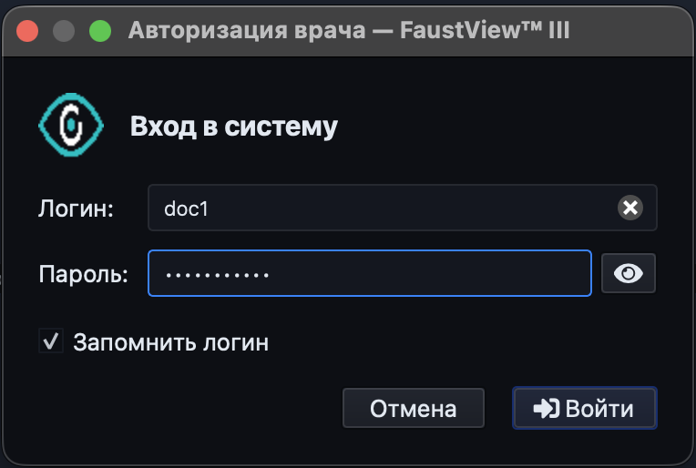
> *Окно входа в систему (логин, пароль, кнопка «Войти»).*

---

### Основной интерфейс

Рабочее окно разделено на две основные зоны:

- **Слева** — реестр пациентов и детальная информация по выбранному исследованию.
- **Справа** — область просмотра маммограмм (до четырёх проекций одновременно).

В верхней части окна расположена панель инструментов.  
В нижней — строка состояния (статус операций, ФИО врача, индикатор связи с сервером).

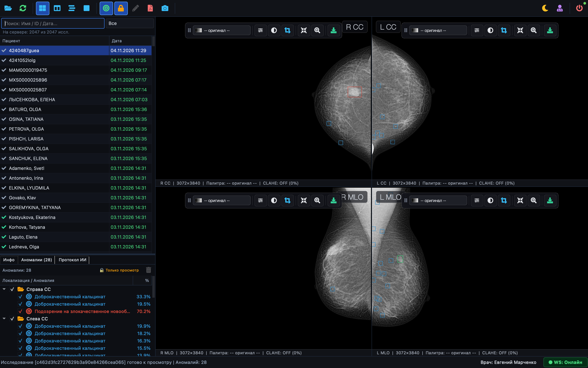 
> *Общий вид главного окна: слева список пациентов, справа четыре проекции, сверху панель инструментов.*

---

### Работа со списком исследований

#### Поиск и фильтры

В верхней части левой панели находятся:

- строка поиска (по имени пациента, ID, дате);
- выпадающий список фильтра комплектности:
  - Все
  - 4/4 Полные
  - 2/4 Односторонние
  - Неполные

Список автоматически сортируется по дате обновления (новые сверху).

#### Индикаторы статуса перед именем пациента

| Значок | Значение |
|--------|----------|
| Серый вопросик | Нет ни результата ИИ, ни мнения врача |
| Серая галочка | Есть предположение ИИ, ждёт проверки врача |
| Зелёная галочка | Есть сохранённое мнение врача |
| Жёлтый треугольник | Ошибка обработки |
| Синие песочные часы | Исследование сейчас обрабатывается ИИ |

Цвет даты в колонке «Дата» дополнительно показывает комплектность:

- зелёный — полное исследование (4 проекции);
- жёлтый — одностороннее (2 проекции одной груди);
- красный — неполный набор.

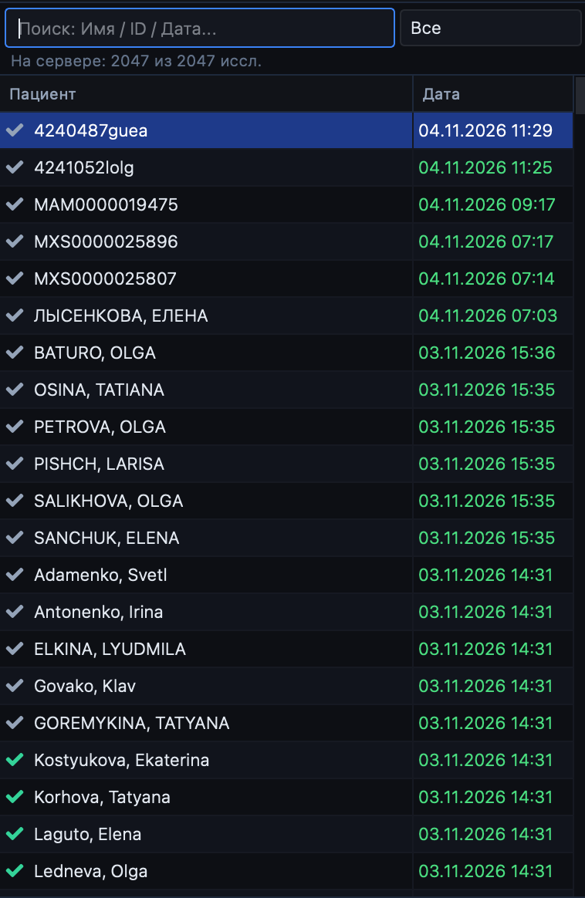
> *Левая панель: список пациентов с иконками статуса и цветными датами, строка поиска и фильтр.*

#### Нижние вкладки левой панели

После выбора исследования в нижней части левой панели появляются три вкладки:

1. **Инфо** — идентификатор пациента, список проекций, статус, полные 32-символьные хэши исследования, результата ИИ и мнения врача (можно выделять и копировать мышью).
2. **Аномалии** — иерархический список находок по проекциям с галочками видимости.
3. **Протокол ИИ** — текстовое описание, сформированное искусственным интеллектом.

Высоту этой зоны можно менять, перетаскивая разделитель.

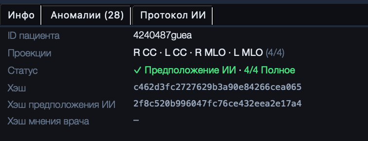
> *Вкладка «Инфо» с полными хэшами и статусом.*  

> *Вкладка «Аномалии» — дерево находок с галочками и процентами.*

---

### Просмотр маммограмм

#### Режимы раскладки

На панели инструментов доступны кнопки:

- **4 проекции** — классическая раскладка 2×2 (`R_CC` | `L_CC` / `R_MLO` | `L_MLO`);
- **2 вертикальные** — две проекции рядом;
- **2 горизонтальные** — две проекции одна над другой;
- **1 снимок** — выбранная проекция на весь экран.

Горячие клавиши:

- `1` … `4` — быстрый переход к одиночному просмотру соответствующей проекции;
- `Esc` — возврат к четырём проекциям;
- двойной клик по снимку — развернуть / свернуть.

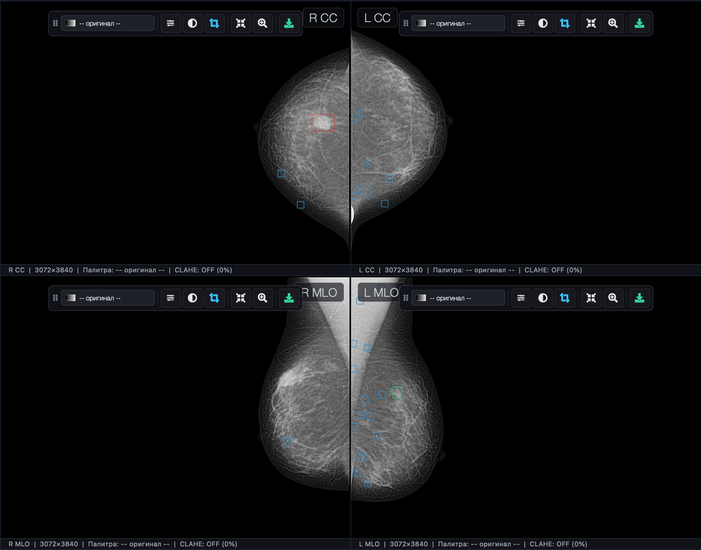
> *Раскладка 4 проекции с загруженными снимками.*  
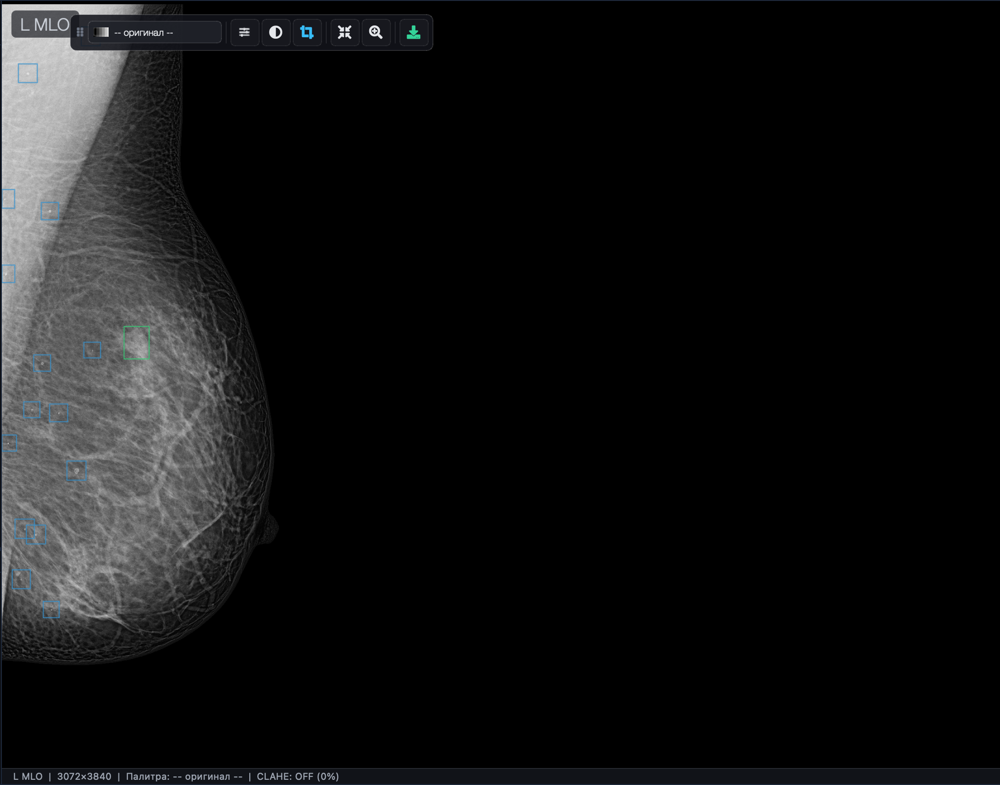  
> *Одиночный режим просмотра одной проекции на весь экран.*

#### Плавающая панель инструментов снимка (HUD)

На каждом снимке в верхней части отображается полупрозрачная панель:

- выбор палитры (Оригинал, Grayscale, Inferno, Hot Iron, PET/Turbo, Magma, Bone, Viridis);
- кнопка CLAHE с регулировкой силы контраста от 0 % до 100 %;
- инверсия (негатив);
- кнопка **ROI** — обрезка по контуру молочной железы (удаляет метки R CC / L MLO и лишний фон);
- вписать в окно / масштаб 100 %;
- сохранить текущее превью в PNG.

Панель можно перетаскивать мышью.

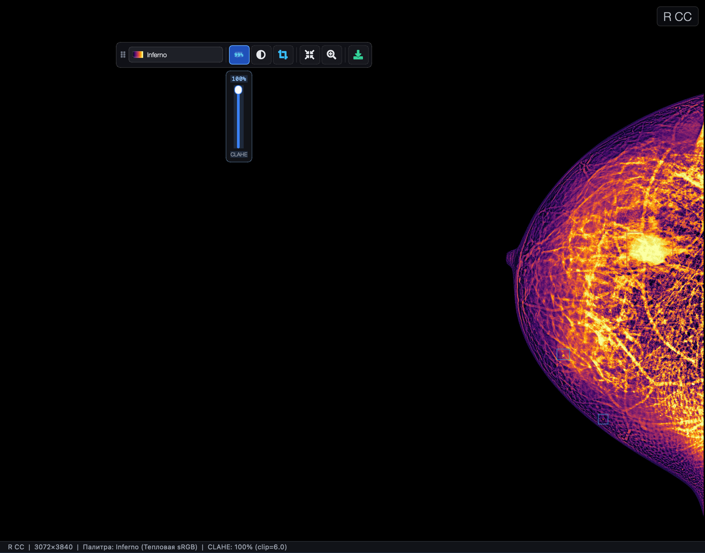 
> *Крупный план одного снимка с открытой плавающей панелью и включённой палитрой Inferno + CLAHE.*  
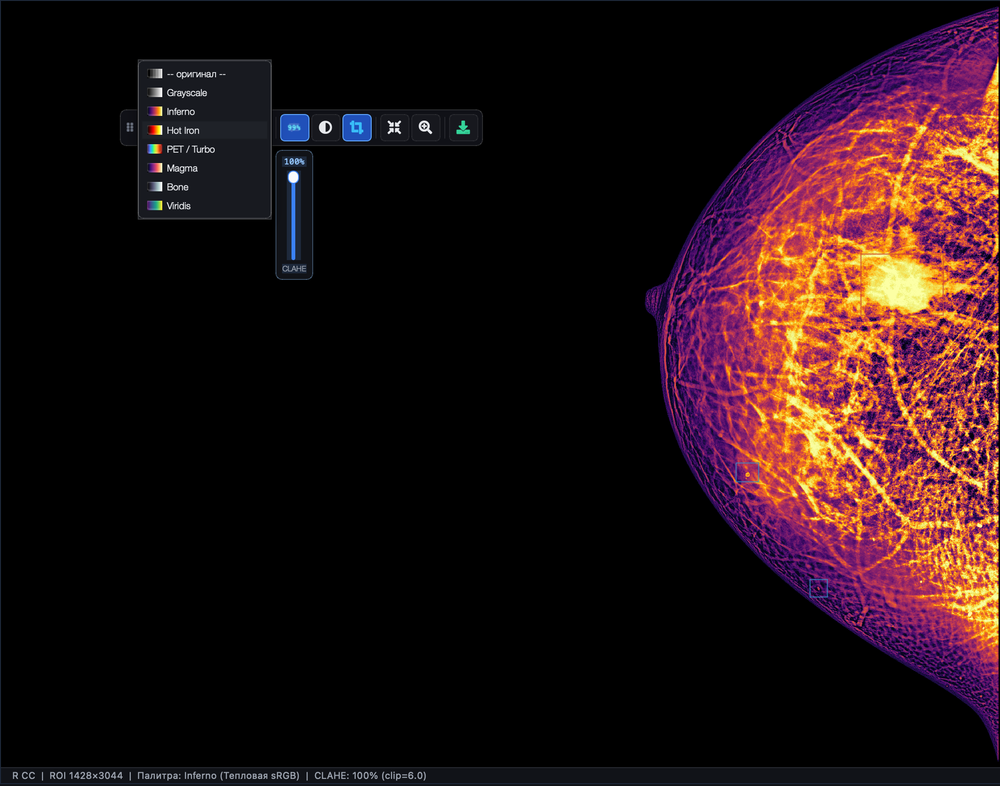 
> *Тот же снимок в режиме ROI (обрезка по железе, метки исчезли).*

#### Масштабирование и навигация

- Колесо мыши — плавный зум относительно курсора.
- Левая кнопка мыши + перетаскивание — панорамирование (когда замок включён).
- При включённом режиме рисования левая кнопка используется для создания новых рамок.

---

### Работа с разметкой

#### Замок редактирования

По умолчанию включён **Замок** (`Ctrl+L`).  
В этом режиме нельзя случайно сдвинуть или удалить рамки.  

Чтобы внести правки:

1. Нажмите кнопку **Замок** на панели инструментов (или `Ctrl+L`).
2. Кнопка сменит вид на «Открыто», станет доступна кнопка **Рисовать**.

>   
> *Панель инструментов с активным замком и неактивной кнопкой «Рисовать».*  
>   
> *Панель инструментов после снятия замка — доступно рисование.*

#### Просмотр и скрытие находок

- Кнопка **Разметка** на верхней панели показывает / скрывает все рамки на снимках.
- В дереве «Аномалии» можно снимать и ставить галочки у отдельных находок — рамка на снимке сразу исчезает или появляется.

Находки ИИ отображаются с иконкой мишени и процентом вероятности.  
Находки, подтверждённые или добавленные врачом, — с иконкой врача и без процентов ИИ.

#### Редактирование существующих рамок

При снятом замке:

- перетаскивайте рамку мышью;
- тяните за углы, чтобы изменить размер;
- двойной клик по рамке или по строке в дереве открывает окно ввода/редактирования текстового описания.

Любое изменение автоматически помечается как «мнение врача» и через короткое время сохраняется на сервер.

> 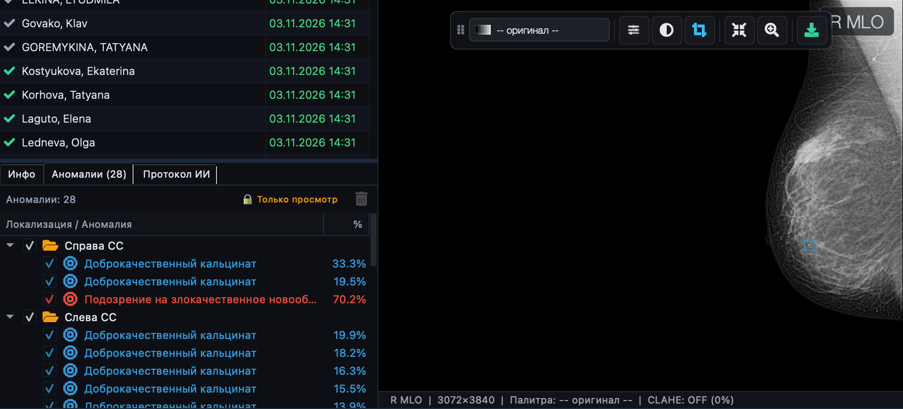  
> *Снимок с рамками аномалий (ИИ и врача) + дерево находок слева.* 

#### Добавление новой находки

1. Снимите замок.
2. Нажмите кнопку **Рисовать**.
3. На снимке зажмите левую кнопку мыши и растяните прямоугольник.
4. В появившемся меню выберите тип находки.
5. При необходимости добавьте текстовое описание.
6. Рамка сразу появляется в дереве «Аномалии» и сохраняется на сервер.

#### Удаление / отклонение находки

- Выделите рамку или строку в дереве и нажмите `Delete` / `Backspace` (или кнопку корзины).
- Для исходных гипотез ИИ рамка просто скрывается (галочка снимается).
- Для рамок, созданных врачом, объект полностью удаляется.

---

### Формирование заключения

1. Выберите исследование.
2. Нажмите кнопку **Заключение** на панели инструментов (или `Ctrl+P`), либо кнопку «Сформировать отчет» на вкладке «Протокол ИИ».
3. В диалоге параметров укажите:
   - включать ли пустые разделы («не выявлено»);
   - выводить ли вероятности ИИ;
   - включать ли текстовые комментарии врача;
   - формировать ли заключение только по подтверждённым врачом рамкам;
   - тип плотности по ACR для правой и левой железы;
   - нужно ли выводить ФИО врача в протоколе.
4. Нажмите «Сформировать заключение».
5. Откроется окно предпросмотра. Из него можно:
   - скопировать текст;
   - сохранить PDF;
   - сразу открыть PDF в системном просмотрщике.

> 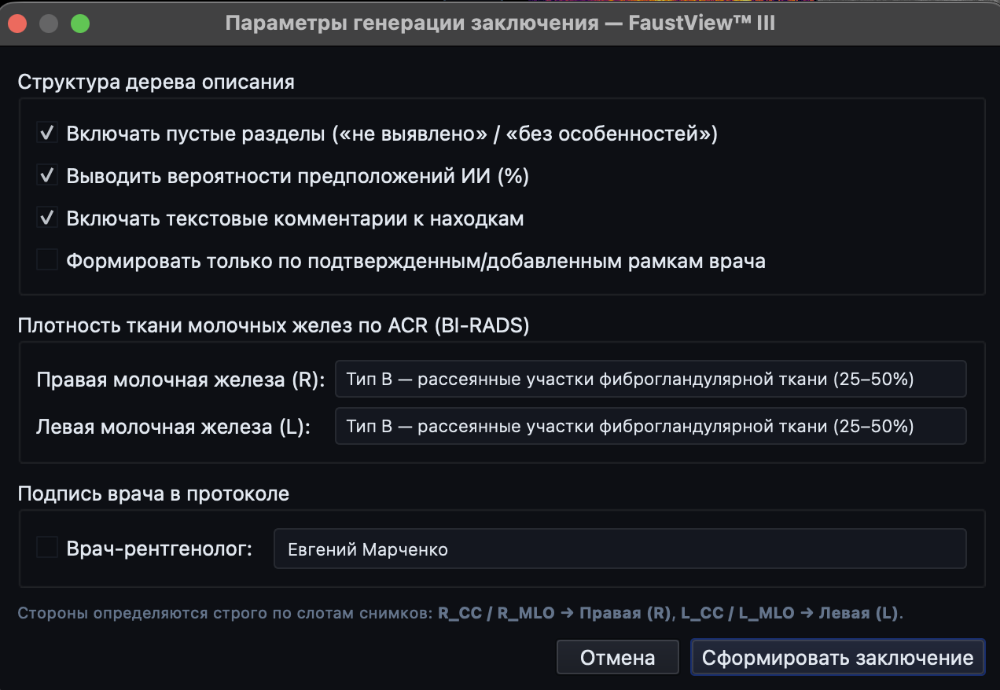 
> *Диалог параметров генерации заключения (ACR, галочки, ФИО врача).*  
> 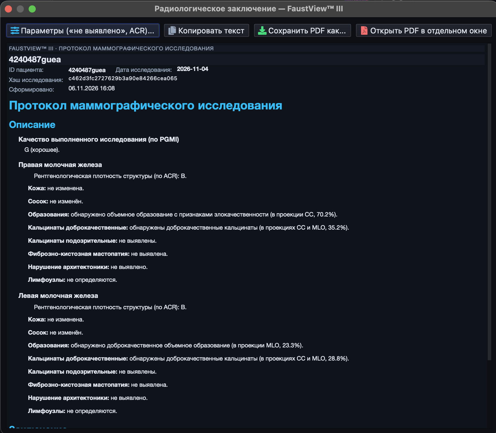 
> *Окно предпросмотра сформированного протокола.*

---

### Загрузка локальных исследований на сервер

1. Нажмите **Открыть** (`Ctrl+O`).
2. Выберите папку, содержащую DICOM-файлы (можно вложенные подпапки).
3. Система просканирует папку, сгруппирует снимки по исследованиям и покажет диалог синхронизации.
4. Дождитесь окончания загрузки. Прогресс отображается в реальном времени.
5. После завершения список исследований на сервере автоматически обновится.

---

### Обновление данных и связь с сервером

- Кнопка **Обновить** (`F5`) — принудительно запрашивает актуальный список исследований с сервера.
- Индикатор в правом нижнем углу показывает состояние WebSocket-соединения:
  - зелёный «WS: Онлайн» — связь есть, push-уведомления приходят автоматически;
  - жёлтый «Переподключение…» — идёт восстановление связи.

При появлении новых результатов ИИ или изменении статуса исследования список обновляется без перезапуска программы.

---

### Темы оформления

В меню **Вид → Тема оформления** доступны три режима:

- Системная (Авто)
- Тёмная (рекомендуется для радиологии)
- Светлая

Быстрое переключение — кнопка «Тема» на панели инструментов.

> 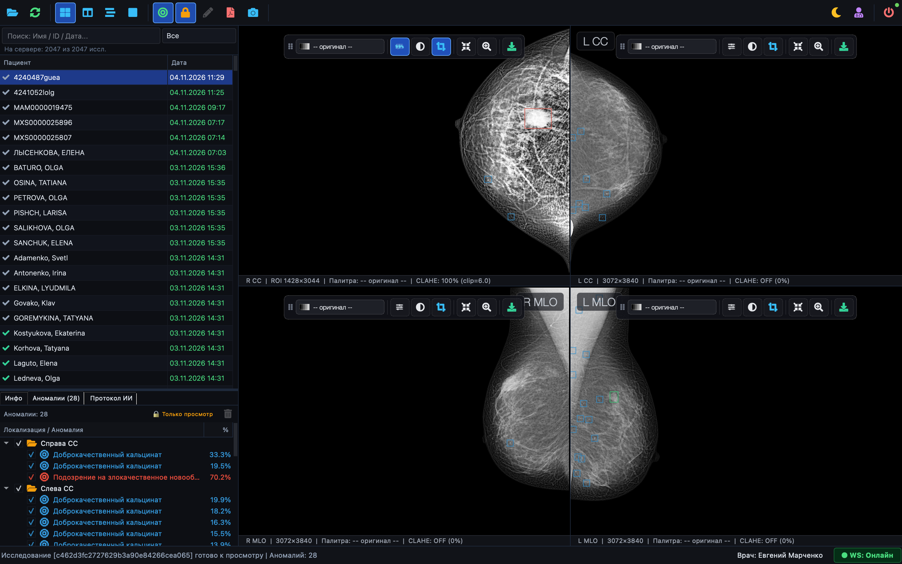  
> *Главное окно в тёмной теме.*  
> 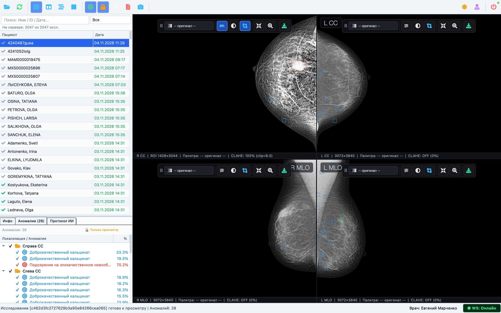  
> *Главное окно в светлой теме (для сравнения).*

---

### Полезные горячие клавиши (краткая шпаргалка)

| Клавиша | Действие |
|---------|----------|
| `Ctrl+O` | Открыть папку для загрузки на сервер |
| `F5` | Обновить список исследований |
| `Ctrl+L` | Включить / выключить замок редактирования |
| `Ctrl+P` | Сформировать заключение |
| `1`–`4` | Одиночный просмотр проекции |
| `Esc` | Вернуться к 4 проекциям |
| `Delete` | Удалить / скрыть выделенную находку |
| `F12` | Сделать скриншот окна и отправить на сервер |
| `Ctrl+T` | Скрыть / показать верхнюю панель инструментов |
| `Ctrl+Q` | Выход |

---

### Рекомендуемый рабочий порядок врача

1. Войти в систему.
2. При необходимости обновить список (`F5`).
3. Найти нужного пациента через поиск или фильтр.
4. Выбрать исследование — дождаться загрузки четырёх проекций.
5. Осмотреть снимки (при необходимости включить ROI, CLAHE, другую палитру).
6. Просмотреть гипотезы ИИ на вкладке «Аномалии» и в протоколе.
7. При необходимости снять замок и внести правки / добавить свои находки.
8. Сформировать заключение и сохранить PDF.
9. Перейти к следующему пациенту.

---

### Что делать, если…

| Ситуация | Решение |
|----------|---------|
| Снимки не загружаются | Проверьте индикатор WS, нажмите F5, при необходимости очистите кэш (Файл → Очистить кэш) |
| Нет разметки ИИ | Возможно, исследование ещё в обработке — подождите или обновите список |
| Случайно сдвинул рамку | Включите замок (`Ctrl+L`) — дальнейшие случайные изменения будут заблокированы |
| Нужно быстро сравнить только одну грудь | Выберите режим «2 вертикальные» и пару «Правая» или «Левая» |

---

## 🏗 Архитектура проекта

```text
fv3/
├── assets/
│   ├── FaustLogo.png                  # Иконка приложения (macOS / Linux)
│   └── FaustLogo.ico                  # Иконка приложения (Windows)
├── src/
│   └── fv3/
│       ├── main.py                    # Точка входа (с автосборкой нативного .app бандла на macOS)
│       ├── roitest.py                 # CLI-утилита тестирования выделения ROI одиночного DICOM
│       ├── core/                      # Ядро обработки данных, DICOM, криптохэшей и сетевого API
│       │   ├── anomaly_catalog.py             # Справочник 13 типов патологий, цветов и генератор HTML-отчета
│       │   ├── api_endpoints.py               # Конфигурация HTTP REST и WebSocket эндпоинтов
│       │   ├── auth_session.py                # Модель сессии и прав доступа врача
│       │   ├── authenticate_doctor.py         # Авторизация (POST /auth/login)
│       │   ├── fetch_current_doctor.py        # Валидация сохраненного токена (GET /auth/me)
│       │   ├── classify_mammogram_dicom.py    # Быстрая классификация DICOM по заголовкам и SNOMED-кодам
│       │   ├── evaluate_study_completeness.py # Оценка комплектности (COMPLETE_4, UNILATERAL_2 и др.)
│       │   ├── group_mammograms_by_study.py   # Многопоточное сканирование папок и расчет xxh3_128
│       │   ├── compress_mammogram_dicom_htj2k.py # Сжатие в HTJ2K Lossless + запись приватных тегов
│       │   ├── build_htj2k_dicom_bytes.py     # Подготовка HTJ2K DICOM-пакета в памяти для отправки
│       │   ├── study_batch_synchronizer.py    # Пакетная сверка и догрузка недостающих снимков на сервер
│       │   ├── ensure_cached_dicom.py         # Скачивание снимков с поддержкой HTTP Range докачки
│       │   ├── decode_dicom_slot.py           # Распаковка HTJ2K, расчет LUT, маски железы и ROI bbox
│       │   ├── fetch_studies_from_server.py   # Получение списка исследований
│       │   ├── fetch_study_markup.py          # Получение и кэширование db.results и db.new_results
│       │   ├── study_markup_consolidator.py   # Слияние разметки ИИ с правками врача и сборка дельты
│       │   ├── save_study_markup_delta.py     # Отправка дельты правок врача на сервер
│       │   ├── macos_bundle_builder.py        # Генератор нативного Mach-O лончера FaustView.app для macOS
│       │   ├── resource_path.py               # Резолвер путей для dev-режима и собранного приложения
│       │   └── log.py                         # Структурированное цветное логирование на базе Rich
│       └── gui/                       # Графический интерфейс PySide6
│           ├── main_window.py                 # Главное окно рабочей станции
│           ├── study_list_panel.py            # Левая панель: поиск, таблица со статусами, сплиттер вкладок
│           ├── study_details_box.py           # Вкладка «Инфо» (ID, проекции, полные 32-символьные хэши)
│           ├── findings_panel.py              # Вкладка «Аномалии» (дерево находок, чекбоксы, синхронизация)
│           ├── report_panel.py                # Вкладка «Протокол ИИ»
│           ├── description_dialog.py          # Модальный редактор врачебного описания аномалии
│           ├── mammogram_quad_workspace.py    # 4-слотовая рабочая область с переключением раскладок
│           ├── slot_container.py              # Контейнер слота маммограммы
│           ├── mammogram_viewer.py            # Вьювер одного снимка (рендер палитр, CLAHE, ROI-кроп)
│           ├── interactive_canvas.py          # QGraphicsView: зум, пан, рисование рамок, сдвиг координат ROI
│           ├── resizable_rect_item.py         # Интерактивная рамка аномалии с контрастным Halo и уголками
│           ├── floating_toolbar.py            # Парящая HUD-панель управления снимком
│           ├── clahe_popup.py                 # Всплывающий слайдер CLAHE (0..100%)
│           ├── study_download_hud.py          # Парящий индикатор прогресса скачивания 4 проекций
│           ├── login_dialog.py                # Окно входа врача в систему
│           ├── study_sync_dialog.py           # Диалог пакетной выгрузки DICOM-архива на сервер
│           ├── server_ws_monitor.py           # Фоновый монитор WebSocket-соединения
│           ├── theme_manager.py               # Менеджер тем оформления (SYSTEM / DARK / LIGHT)
│           └── *_worker.py                    # Фоновые потоки QThread (сканирование, загрузка, сохранение)
└── tmp/
    ├── test_compress.py               # Тестирование степени и скорости сжатия HTJ2K Lossless
    └── test_path.py                   # Тестирование сканера директорий и группировки исследований
```

---

## 🚀 Требования и установка

Проект использует современный менеджер пакетов и виртуальных окружений **[uv](https://docs.astral.sh/uv/)**.

### Основные зависимости:
* **Python** $\ge 3.11$ (поддерживается вплоть до Python $3.14$)
* `PySide6` + `qtawesome` — графический интерфейс и векторная иконографика
* `pydicom` + `imagecodecs` — чтение DICOM и аппаратно-ускоренный кодек OpenJPH (HTJ2K)
* `numpy` + `opencv-python` (`cv2`) — матричные операции, морфология, CLAHE и палитры
* `xxhash` — криптографически быстрый расчет 128-битных хэшей изображений (`xxh3_128`)
* `httpx` — синхронный/потоковый HTTP-клиент с пулом соединений и докачкой (`Range`)
* `rich` — форматированный вывод логов и трассировок в консоль

### Быстрый старт:
```bash
# Переход в директорию проекта
cd Desktop/fv3

# Запуск рабочей станции (uv автоматически создаст/проверит окружение .venv)
uv run python src/fv3/main.py
```
> **Примечание для macOS:** При первом запуске на macOS модуль `macos_bundle_builder.py` автоматически скомпилирует нативный бандл `.venv/FaustView.app` с иконкой `FaustLogo.icns`, чтобы в системном Dock, переключателе `Cmd+Tab` и верхнем меню отображалось имя **«FaustView™ III»** вместо `Python`.

---

### Горячие клавиши и управление холстом
| Клавиша / Действие | Назначение |
| :--- | :--- |
| **Колесо мыши** | Плавное масштабирование снимка относительно курсора |
| **ЛКМ + Перетаскивание** | Панорамирование снимка (в режиме чтения) или перемещение рамки (при снятом замке) |
| **Двойной клик по снимку** | Развернуть текущий слот на весь экран / вернуться к раскладке $2 \times 2$ |
| **Двойной клик по аномалии** | Открыть диалог редактирования врачебного комментария (при снятом замке) |
| **`1`, `2`, `3`, `4`** | Быстрое переключение на одиночный просмотр слота `R_CC`, `L_CC`, `R_MLO`, `L_MLO` |
| **`Esc`** | Возврат в режим 4 проекций ($2 \times 2$) |
| **`Ctrl + L`** | Включить / выключить **Замок** блокировки редактирования разметки |
| **`Delete` / `Backspace`** | Удалить созданную врачом рамку или снять галочку с гипотезы ИИ (при снятом замке) |
| **`Ctrl + O`** | Открыть локальную папку с DICOM-файлами для пакетной синхронизации с сервером |
| **`F5` (`Ctrl + R`)** | Обновить список исследований с сервера |
| **`Ctrl + T`** | Скрыть / показать верхнюю главную панель инструментов |
| **`Ctrl + Q`** | Выход из программы |

---

## 🎨 Справочник типов аномалий (Экспликация)

Цвета рамок на холсте и строк в списке аномалий строго соответствуют утвержденному классификатору `AnomalyCatalog`:

| Код | Наименование патологии / находки | HEX-цвет |
| :---: | :--- | :---: |
| **0** | Доброкачественное объемное новообразование | `#2ecc71` |
| **1** | Подозрение на злокачественное новообразование | `#e74c3c` |
| **2** | Доброкачественный кальцинат | `#3498db` |
| **3** | Злокачественный кальцинат | `#c0392b` |
| **4** | Объемное новообразование | `#e67e22` |
| **5** | Фибро-кистозная мастопатия | `#9b59b6` |
| **6** | Лимфоузел (более 1 см) | `#f1c40f` |
| **7** | Лимфоузел (менее 1 см) | `#f39c12` |
| **8** | Не определено | `#95a5a6` |
| **9** | Кальцинированная киста | `#1abc9c` |
| **10** | Кальцинированные сосуды | `#34495e` |
| **11** | Утолщение кожи | `#d35400` |
| **12** | Втянутый сосок | `#8e44ad` |

---

## 🛠 Локальное кэширование и диагностика

Для мгновенного отклика интерфейса рабочая станция хранит кэш в домашней директории пользователя `~/.cache/fv3/`:
* `~/.cache/fv3/images/` — скачанные с сервера оригинальные DICOM-файлы (`<image_hash>.dcm`). Поддерживается автоматическая докачка при обрыве связи через HTTP `Range`.
* `~/.cache/fv3/fast8_v2/` — предрассчитанные 8-битные буферы отображения, маски контура молочной железы и координаты `roi_bbox` (`<image_hash>_<slot_key>.npz`). Позволяют открывать 4 снимка за $\approx 0.02\text{ с}$ без повторного декодирования HTJ2K.
* `~/.cache/fv3/results/` — локальный JSON-кэш протоколов ИИ (`<result_hash>.json`) и врачебных правок (`new_<new_result_hash>.json`).

### Вспомогательные CLI-утилиты:
1. **Проверка сканирования и группировки папки с DICOM:**
   ```bash
   uv run python tmp/test_path.py /путь/к/папке/с/маммограммами
   ```
2. **Тестирование сжатия маммограмм в HTJ2K Lossless:**
   ```bash
   uv run python tmp/test_compress.py /путь/к/файлу_или_папке -o tmp/htj2k_out
   ```
3. **Отладка выделения ROI одиночного DICOM-снимка:**
   ```bash
   uv run python src/fv3/roitest.py input.dcm output_roi.dcm preview.png --pad 10
   ```